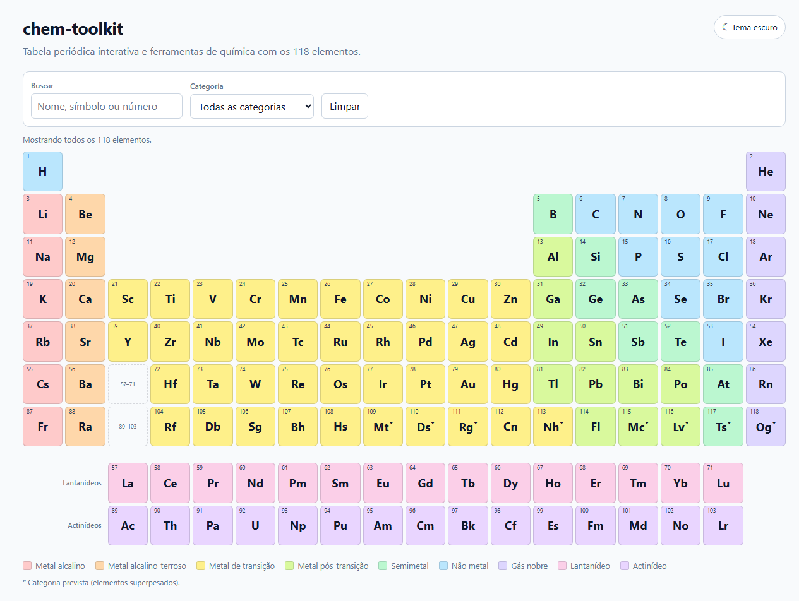
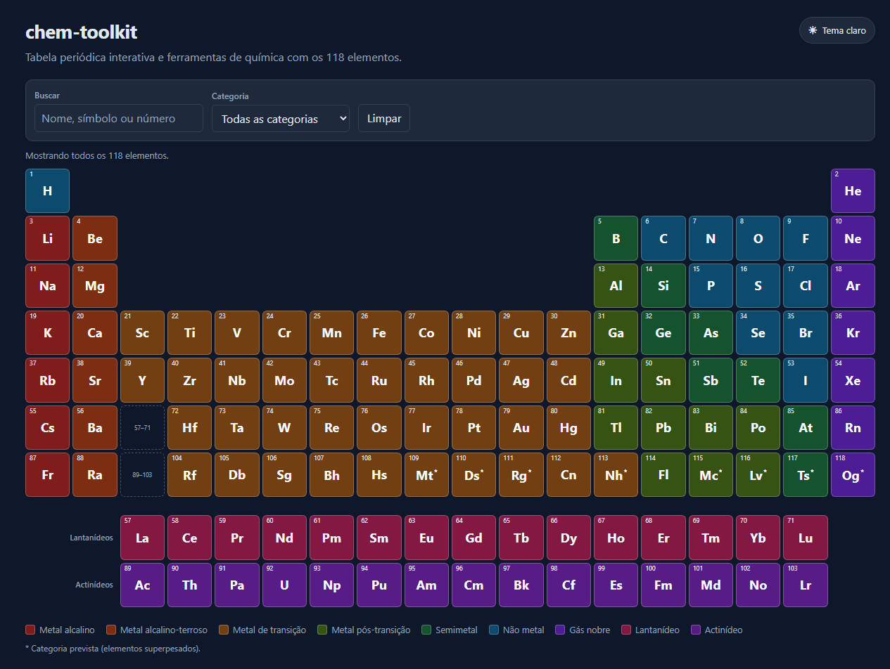
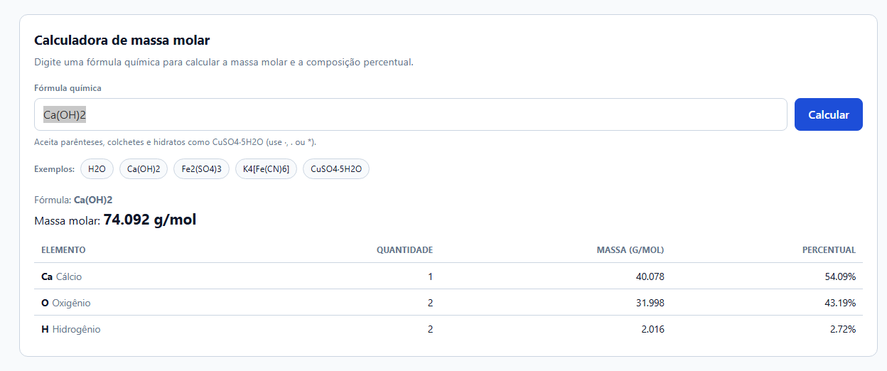
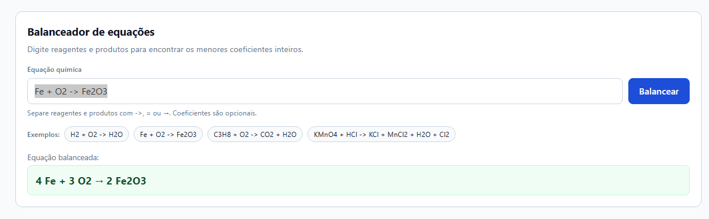
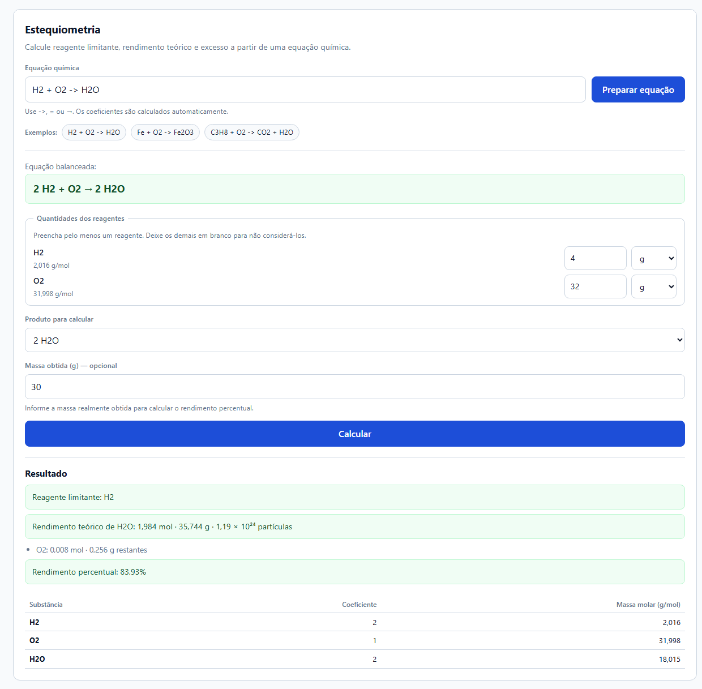
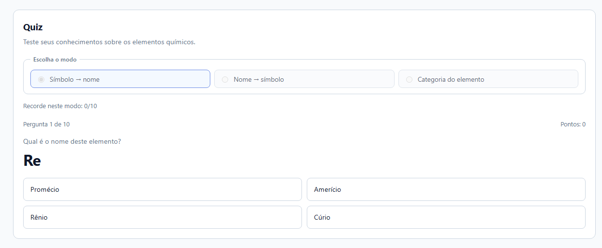

# chem-toolkit

[](https://github.com/wenderson-hgs/projeto/actions/workflows/ci.yml)

Tabela periódica interativa e ferramentas de química feitas com HTML, CSS e TypeScript puros — sem framework e sem backend.

> **Demo online:** [wenderson-hgs.github.io/projeto](https://wenderson-hgs.github.io/projeto/)
>
> **Código-fonte:** [github.com/wenderson-hgs/projeto](https://github.com/wenderson-hgs/projeto)

## Funcionalidades

- **Tabela periódica interativa** com os 118 elementos, cores por categoria e legenda.
- **Painel de detalhes** com grupo e período rotulados, estado físico, configuração eletrônica, eletronegatividade, pontos de fusão e ebulição, densidade e bloco.
- **Calculadora de massa molar** com composição percentual por elemento.
- **Balanceador de equações** com frações exatas e menores coeficientes inteiros.
- **Estequiometria** com reagente limitante, rendimento teórico em mol, gramas e partículas, excesso e rendimento percentual.
- **Quiz** com três modos, rodadas de 10 perguntas, recorde salvo no navegador e revisão dos erros ao final.
- **Tema claro e escuro**, com preferência salva no `localStorage`.
- **Acessibilidade**: navegação por teclado na tabela com um único ponto de Tab, setas para percorrer os elementos, foco gerenciado no painel de detalhes, foco visível, `aria-label`, link para pular ao conteúdo e layout responsivo.

### Tabela periódica

Busque por nome, símbolo ou número atômico, filtre por categoria e clique em um elemento para ver os detalhes: massa atômica, categoria, grupo e período rotulados, estado físico, configuração eletrônica, eletronegatividade de Pauling, pontos de fusão e ebulição (em °C), densidade e bloco. Valores não disponíveis na fonte aparecem como `—`. As setas do teclado navegam entre as células; `Enter` abre os detalhes; `Esc` fecha o painel e devolve o foco à célula.

### Calculadora de massa molar

Aceita fórmulas simples (`H2O`), parênteses e colchetes aninhados (`K4[Fe(CN)6]`), hidratos com `·`, `.` ou `*` (`CuSO4·5H2O`), subscritos Unicode (`H₂O`) e estados físicos no fim da fórmula (`H2O(s)`, `H2O(l)`, `H2O(g)`, `H2O(aq)`). O resultado mostra a massa molar total e a composição percentual de cada elemento.

### Balanceador de equações

Aceita `->`, `=` ou `→` entre reagentes e produtos, por exemplo `Fe + O2 -> Fe2O3`. O cálculo usa frações exatas, sem arredondamento de ponto flutuante, e sempre devolve os menores coeficientes inteiros. Coeficientes digitados são opcionais.

### Estequiometria

Digite a equação e clique em **Preparar equação**: ela é balanceada automaticamente e as massas molares são calculadas. Depois, informe a quantidade de pelo menos um reagente em gramas ou mol, escolha o produto e clique em **Calcular**. O resultado mostra o reagente limitante, o rendimento teórico do produto em mol, gramas e partículas, quanto sobra de cada reagente em excesso e, se você informar a massa realmente obtida, o rendimento percentual. Reagentes deixados em branco são listados como “sem quantidade informada”, e massas atômicas aproximadas geram um aviso. A ferramenta não calcula volume de gases, soluções, molaridade nem pureza.

### Quiz

Três modos: símbolo → nome, nome → símbolo e categoria do elemento. Cada rodada tem 10 perguntas com 4 alternativas, feedback imediato e pontuação. Ao final, a revisão dos erros mostra a pergunta, a resposta escolhida e a resposta correta; se todas estiverem certas, aparece uma mensagem positiva. A última pontuação e o recorde de cada modo ficam salvos no `localStorage` do navegador.

## Capturas de tela

### Tema claro



### Tema escuro



### Calculadora de massa molar



### Balanceador de equações



### Estequiometria



### Quiz



## Como rodar

Pré-requisitos: [Node.js](https://nodejs.org/) LTS (20.19 ou superior) e npm.

```bash
npm install      # instala as dependências
npm run dev      # inicia o servidor de desenvolvimento
npm test         # roda os testes unitários
npm run build    # gera a versão de produção em dist/
npm run preview  # visualiza a versão de produção
npm run lint     # verifica o código com ESLint
npm run format   # formata o código com Prettier
```

O servidor de desenvolvimento fica em `http://localhost:5173/projeto/`, porque o build usa `base: '/projeto/'` para o GitHub Pages.

## Testes

Os testes unitários usam [Vitest](https://vitest.dev/) e cobrem:

- integridade dos 118 elementos e das categorias;
- propriedades físicas, rótulos de grupo/período e exibição de valores ausentes;
- parser de fórmulas, massas molares e casos de erro;
- balanceamento com frações exatas, equações impossíveis e múltiplas soluções;
- estequiometria com reagente limitante, excesso, rendimento teórico, rendimento percentual e erros de entrada;
- geração de perguntas, alternativas, revisão de erros e armazenamento de pontuação;
- leitura e gravação do tema claro/escuro.

A interface é verificada manualmente com `npm run dev`; o projeto não usa testes de navegador.

## Estrutura

```text
.
├─ .github/
│  └─ workflows/
│     ├─ ci.yml               # lint, testes e build em pull requests
│     └─ deploy.yml           # testes, build e deploy no GitHub Pages
├─ docs/
│  ├─ CLAUDE_HANDOFF.md
│  └─ screenshots/
├─ public/
│  ├─ favicon.svg
│  └─ social-card.png         # imagem 1200×630 para Open Graph e Twitter Card
├─ src/
│  ├─ data/
│  │  ├─ elements.json        # 118 elementos com propriedades físicas (CC BY-SA 3.0)
│  │  └─ README.md            # fonte, licença e alterações dos dados
│  ├─ lib/                    # lógica de química, quiz, tema e tipos
│  ├─ ui/                     # tabela, painel, calculadora, balanceador, estequiometria, quiz e tema
│  ├─ styles/                 # CSS por componente e variáveis de tema
│  └─ main.ts                 # composição da aplicação
├─ tests/                     # testes unitários com Vitest
├─ index.html
├─ vite.config.ts             # base '/projeto/' para o GitHub Pages
├─ package.json
└─ README.md
```

A lógica de química fica em `src/lib/`, separada da interface, para poder ser testada sem navegador.

## Deploy

O deploy é automático: todo push na branch `main` roda testes, lint e build no GitHub Actions e publica a pasta `dist` no GitHub Pages. Pull requests também passam por lint, testes e build no workflow `CI`, sem publicar nada.

No repositório, em **Settings → Pages → Source**, a opção precisa estar em **GitHub Actions**.

## Dados e licenças

Os dados dos 118 elementos estão em [`src/data/elements.json`](src/data/elements.json). A fonte, a licença e as alterações estão documentadas em [`src/data/README.md`](src/data/README.md).

Resumo:

- estrutura, massas, categorias, posições e propriedades físicas derivadas do [Periodic-Table-JSON](https://github.com/Bowserinator/Periodic-Table-JSON) (CC BY-SA 3.0);
- nomes em português do Brasil obtidos do [Wikidata](https://www.wikidata.org/) (CC0), com revisão manual da nomenclatura brasileira;
- massas atômicas convencionais da IUPAC, exibidas com 3 casas decimais e separador decimal brasileiro (vírgula).

O arquivo de dados é distribuído sob **CC BY-SA 3.0**. O código do projeto é distribuído sob a **licença MIT** — veja [LICENSE](LICENSE).

## Limitações conhecidas

- O balanceador cobre fórmulas neutras; não trata cargas iônicas nem equações redox com íons (por exemplo, `Fe2+`).
- A estequiometria considera que a reação é completa e que os coeficientes balanceados representam a proporção real. Ela não calcula volume de gases, soluções/molalidade, pureza ou impurezas, e as quantidades dos reagentes são aceitas apenas em gramas ou mol.
- A calculadora aceita subscritos e estados físicos, mas não cargas iônicas (`Fe2+`, `SO4^2-`) nem coeficientes estequiométricos no início da fórmula (`2H2O`).
- A pontuação e o recorde do quiz ficam no navegador: limpar os dados do site ou trocar de dispositivo zera o histórico. Em navegação privada, o recorde pode não persistir.
- Elementos sem massa atômica padrão da IUPAC usam o número de massa do isótopo mais estável; a calculadora exibe um aviso de valor aproximado.
- Alguns elementos superpesados não têm eletronegatividade, ponto de fusão, ponto de ebulição ou densidade na fonte; esses campos aparecem como `—` no painel.
- As temperaturas são armazenadas em kelvin e convertidas para graus Celsius na interface; pequenas diferenças de arredondamento em relação a tabelas impressas são esperadas.
- Não há backend: todas as contas são feitas no navegador.

## Créditos

Feito por [Wenderson](https://github.com/wenderson-hgs) como projeto de estudo de TypeScript, química e publicação no GitHub Pages.
